# MPLX

A C++20 language toolchain: typed control-flow IR, verified bytecode, a bounded
interpreter, an x64 JIT with native calls, a compiler-backed language server,
VS Code extension, C ABI and .NET embedding.

[Reviewer guide](docs/REVIEWER_GUIDE.md) · [Language](docs/LANGUAGE.md) ·
[Module format](docs/MODULE_FORMAT.md) · [Embedding](docs/EMBEDDING.md) ·
[Modules/cache](docs/MODULES.md) ·
[Validation](docs/VALIDATION.md) · [Roadmap](docs/ENGINEERING_ROADMAP.md)

The [M01–M65 program](docs/vision/engineering-roadmap.md) retains the complete
flagship scope and explicit acceptance gates. The current working tree adds
[scalar semantics v1](docs/language/specification.md), reusable compiler analyses,
interprocedural effect/range proofs and
[transactional pass snapshots/replay](docs/compiler/analysis-and-replay.md).
These are implemented compiler foundations; composite language types and managed
memory remain the next vertical milestone.

All maintained and historical source files follow the repository's four-space
formatting rules. Run `npm run format` or `npm run format:check` after installing
the [formatting tools](docs/FORMATTING.md); CI checks the complete source tree.

## New in 0.6

- Explicit import namespaces and export visibility; root-confined file loading,
  cycle diagnostics and deterministic whole-program IR linking.
- Incremental parsed/semantic caches keyed by exact source and export interfaces;
  unchanged builds reuse a verified artifact, with observable build statistics.
- Persistent C/.NET workspace handles accept unsaved source overlays and return
  independent executable programs; live unchanged programs share native code.
- Filesystem-backed LSP indexing, cross-file definitions/references/signatures,
  qualified completion and compiler-validated transactional rename.
- File watcher invalidation, stale-generation rejection, multi-module fuzzing
  and process-level tests over stdio and VS Code IPC.

## Portable runtime foundation (0.5)

- Portable .mplxb modules: fixed-width little-endian sections, CRC32C,
  typed exports, source maps and bounded validation before execution.
- Shared immutable verified programs; concurrent execution instances with
  independent stacks, budgets, cancellation and statistics. One lazily published
  native mapping serves all instances of a program.
- Typed host arguments, CLI build/inspect/run-module commands, opaque C handles
  and .NET SafeHandle ownership for compile-once/load-once execution.
- Independent binary-format fixtures, checksum-repaired module fuzzing, C11 ABI
  tests and a separate ThreadSanitizer configuration.

## Compiler and runtime foundation

- Separate name resolution and type checking: i32, i64, bool, lexical scopes,
  shadowing, checked conversions and exact source spans.
- Typed IR with basic blocks and virtual values. Verification checks types,
  signatures, dominance, definite assignment and control-flow targets.
- Trap-preserving constant folding and dead-value elimination after semantic
  validation. CFG liveness and interference coloring reuse temporary slots.
- Independent bytecode decoding/verification before execution. Immutable modules,
  separate locals/operands/frames, checked arithmetic, bounded instructions,
  frame depth and live values, host cancellation and source-mapped errors.
- x64 native modules: loops, calls, recursion and mutual recursion. Explicit
  arena-backed frames and continuations keep language recursion off the host
  stack. RW -> RX memory, precise budgets/traps and backend telemetry.
- Persistent compiler analysis; LSP diagnostics, hover, definitions, references,
  completion, signature help, capture-safe rename, symbols and semantic tokens.
  Immutable document versions, UTF-8 -> UTF-16 ranges and stale-response rejection.
- Versioned bounded C ABI and tested .NET P/Invoke ownership.
- CTest, generated differential programs, malformed-module mutations,
  process-level LSP tests, ASan/UBSan and source/bytecode fuzz targets.

Native execution requires x64. Oversized native modules/frames, tracing and host
cancellation use the interpreter; counters expose fallback. Host entry functions
accept typed i32/i64/bool parameters through checked i64 carriers. Workspace
symbols include indexed closed files within the first workspace root. Strings,
arrays, cyclic modules and multi-root project graphs remain future milestones. Historical
network/ORM/package modules are outside the maintained core.

## Build and test

CMake 3.26+, a C++20 compiler; Node 22+ for tooling/integration tests.
The C++ core has no third-party dependencies. .NET 8+ is optional.

```sh
cmake --preset dev
cmake --build --preset dev
ctest --preset dev

cmake --preset jit
cmake --build --preset jit
ctest --preset jit
build/jit/bin/mplx --run examples/native_calls.mplx --jit on --jit-verify --stats --no-runfile
```

The native calls example returns 17711. On x64, stats show jit_executions=1,
jit_fallbacks=0 and native_calls=57326.

For Visual Studio on Windows use dev-msvc. Executables always live in
build/<preset>/bin; Windows uses mplx.exe. Historical bootstrap/extend scripts
generate source and are not the build entry point.

## Inspect the compiler

```sh
mplx --check examples/runtime_showcase.mplx
mplx --analyze examples/runtime_showcase.mplx
mplx --dump-ir examples/native_calls.mplx
mplx --dump-passes examples/ssa.mplx
mplx --dump-machine examples/ssa.mplx
mplx --dump-bytecode examples/native_calls.mplx
mplx --dump-cfg examples/native_calls.mplx
mplx --run examples/limits.mplx --max-steps 100 --no-runfile
```

--check returns JSON diagnostics; --analyze adds compiler symbol facts.
--dump-ir emits typed IR JSON. --no-opt disables IR optimization.
The default pipeline promotes locals to SSA and verifies seven transformations.
The x64 backend allocates and coalesces values in R8-R11 within basic blocks.
An independent bounded AST oracle compares raw/SSA/native semantics in tests.
See [COMPILER_PIPELINE.md](docs/COMPILER_PIPELINE.md) for contracts and benchmarks.
--max-steps, --max-frames and --max-values set execution budgets.
--entry selects the entry function. --run prints Result: <integer> and writes
run.txt beside the source unless --no-runfile is set (or --out PATH).
--arg supplies one signed host argument and can be repeated.
Machine-readable commands use stdout; trace/stats use stderr.
Exit codes: 0 success; 1 source/runtime/I/O failure; 2 CLI argument error;
3 interpreter/native verification mismatch.

## Portable programs

```sh
mplx --build examples/embedding.mplx --out build/embedding.mplxb
mplx --inspect-module build/embedding.mplxb
mplx --run-module build/embedding.mplxb --entry transform --arg 21 --arg 2 --arg 1 --jit on --jit-verify --no-runfile
```

The result is 42. Modules retain export signatures and source-mapped traps;
native code is compiled for the loading host. Failed builds preserve the
previous output. See the [wire contract](docs/MODULE_FORMAT.md).

## Source modules and incremental hosts

```sh
mplx --workspace examples/modules/main.mplx
mplx --run examples/modules/main.mplx --jit on --jit-verify --no-runfile
mplx --build examples/modules/main.mplx --out build/pipeline.mplxb
```

The three-module example returns 42. Paths resolve relative to the importer,
inside the current directory or --root PATH. Only export fn declarations are
visible through an imported namespace. See [module contracts](docs/MODULES.md).

```csharp
using var workspace = new MplxWorkspace(projectRoot);
using var first = workspace.Compile("main.mplx");
using var unchanged = workspace.Compile("main.mplx");
Console.WriteLine(unchanged.Statistics.ArtifactHit); // true
using var instance = unchanged.Program.CreateInstance();
Console.WriteLine(instance.Invoke().Result);
```

## Editor tooling

```sh
cd Presentation/Mplx.Lsp
npm ci
npm run build
npm test -- ../../build/jit/bin/mplx
cd ../vscode-mplx
npm ci
npm run build
npx @vscode/vsce package --skip-license
```

Use mplx.exe on Windows. Install the VSIX and configure mplx.cliPath, or let
the extension detect dev/dev-msvc/jit/release builds. See the
[extension guide](Presentation/vscode-mplx/README.md) and
[LSP contract](Presentation/Mplx.Lsp/README.md). The compiler is built separately
from the extension. Rename rejects lexical capture and binding changes;
compiler analysis already running in the child is not preempted.

## Measure actual execution

```sh
mplx --bench examples/native_calls.mplx --mode run-only --runs 50 --warmup 5 --jit on --json
node scripts/benchmark.mjs build/release/bin/mplx examples/native_loop.mplx build/loop.json 50
node scripts/benchmark.mjs build/release/bin/mplx examples/native_calls.mplx build/calls.json 50
```

run-only reuses the VM; compile-run includes frontend, verification and VM
construction. Entry-file reading and warmups are excluded; multi-file compile-run
includes dependency reads and linking. Reports include raw samples,
p50/p95, source hash, CPU/OS/compiler/build/version and actual native execution/call
counts. With zero warmups native compilation can enter the first sample.
Resource consumption may change with optimization.
[Windows reports](docs/benchmarks/) describe individual workloads on one machine.

## Embedding

```c
#include <mplx/mplx.h>
mplx_runtime_options options = {sizeof(options), MPLX_ABI_VERSION, 100000, 128, 10000};
long long result = 0;
char *error = 0;
int status = mplx_run_from_source_ex(source, "main", &options, &result, &error);
mplx_free(error);
```

The caller frees returned strings with mplx_free. Source diagnostics prevent
execution. Legacy entry points remain available with default budgets.
Legacy calls use interpretation. Program/instance handles support repeated
execution and explicit JIT selection; [embedding contracts](docs/EMBEDDING.md)
define ownership, concurrency and cancellation.

```csharp
using var program = MplxProgram.Compile(source);
using var instance = program.CreateInstance(MplxJitMode.On, cancellable: false);
var result = instance.Invoke("transform", new long[] {21, 2, 1},
    new MplxExecutionOptions(MaxInstructions: 100_000));
```

Test against the fresh native binary:

`Mplx.sln` contains the maintained managed binding, sample and interop checks.
Build it after CMake, passing the freshly built native path as shown below.

```powershell
dotnet run --project Presentation/tests-dotnet -c Release -p:MplxNativePath="$PWD/build/jit/bin/mplx_native.dll" -p:MplxNativeFileName=mplx_native.dll
```

Linux uses build/jit/lib/libmplx_native.so; macOS uses libmplx_native.dylib.

## Architecture and validation

```mermaid
flowchart LR
  Files[Sources / unsaved overlays] --> Graph[Dependency graph / snapshots / cache]
  Graph --> Source
  Source --> Syntax[Lexer / AST / spans]
  Syntax --> Semantic[Resolver / types / symbol identities]
  Semantic --> IR[Typed CFG IR / verifier]
  IR --> Optimize[Trap-preserving optimization / liveness]
  Optimize --> Link[IR linking / verification]
  Link --> Bytecode[Bytecode / source map / verifier]
  Bytecode --> Program[Shared verified program]
  File[Portable module / bounded reader] --> Program
  Program --> VM[Independent bounded interpreter instances]
  Program --> JIT[Shared x64 module / explicit frames / W^X]
  Semantic --> Service[Persistent compiler service]
  Service --> LSP[LSP / versioned snapshots]
  VM --> Hosts[CLI / C ABI / .NET]
  JIT --> Hosts
```



CMake enforces core library dependencies. Domain owns syntax; Application owns
semantics, IR and execution; Infrastructure owns external ABIs; Presentation owns
tools/tests. [ADRs](docs/adr/) explain the verification, ownership, native ABI and
editor contracts.

CI defines Windows/Linux/macOS builds, ASan/UBSan/TSan, four fuzz targets,
.NET and LSP.
[Validation](docs/VALIDATION.md) records what actually ran locally and what remains
unverified. Install with cmake --install build/release --prefix build/install.
