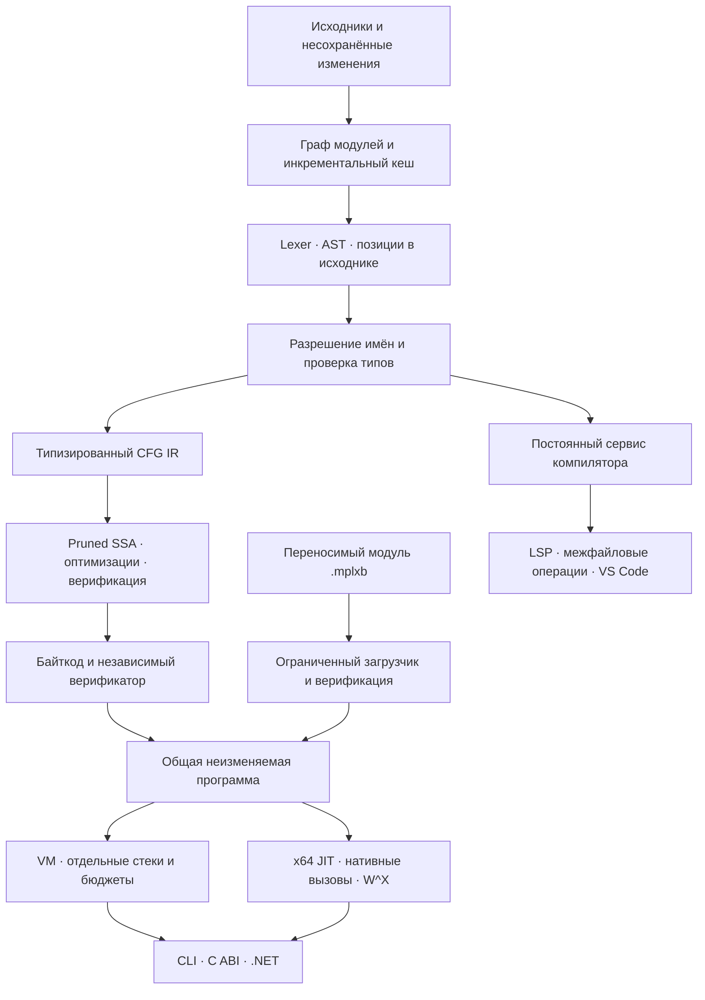

# MPLX

**Компилятор, встраиваемая среда исполнения и инструменты разработки собственного языка.**

MPLX проводит программу через весь цикл: разбор исходников, проверку типов,
построение графа управления, оптимизацию в SSA, верификацию байткода и исполнение
в VM или собственном x64 JIT. Тот же компилятор обслуживает языковой сервер,
межфайловую навигацию и переименование в VS Code. Через C ABI и .NET программу
можно скомпилировать один раз и исполнять в независимых контекстах.

Ядро написано на **C++20** без сторонних библиотек. Языковой сервер и расширение —
на **TypeScript**, управляемая обвязка — на **C#**. Главный инженерный фокус —
проверяемые преобразования, явные границы ресурсов и согласованная семантика
между независимыми движками исполнения.

## Что реализовано

| Область     | Реализация                                                                                                                                                  |
| ----------- | ----------------------------------------------------------------------------------------------------------------------------------------------------------- |
| Язык        | `i32`, `i64`, `bool`, проверяемая арифметика и преобразования, лексические области, функции, циклы, рекурсия и взаимная рекурсия                            |
| Компилятор  | Типизированный CFG IR, pruned SSA, phi-узлы, семь проходов оптимизации и верификация каждого результата                                                     |
| Анализы     | Доминирование и его границы, постдоминирование, SCC, естественные и неприводимые циклы, def-use, liveness, межпроцедурные эффекты и целочисленные диапазоны |
| Исполнение  | Верифицированный стековый байткод, ограниченная VM, x64 JIT, нативные вызовы, явные кадры и счётчики фактического исполнения                                |
| Модули      | Импорты и экспорт, граф зависимостей, ограничение файлов корнем проекта, инкрементальные синтаксические и семантические кеши                                |
| Артефакты   | Переносимый формат `.mplxb`, типизированные точки входа, карты исходников, CRC32C и проверка перед загрузкой                                                |
| Инструменты | CLI, снимки и воспроизведение проходов, LSP, VS Code, C ABI, .NET SafeHandle и persistent workspace API                                                     |

## Как выглядит язык

```text
fn fib(n: i64) -> i64 {
    if (n <= 1) {
        return n;
    }

    return fib(n - 1) + fib(n - 2);
}

fn main() -> i64 {
    return fib(22);
}
```

Результат — `17711`. Переполнение, деление на ноль и недопустимое сужение типа
дают ошибку с позицией в исходнике. Проверка имён и типов выполняется до
оптимизации; удаление недостижимого кода не скрывает ошибки исходной программы.

Модули используют явное пространство имён:

```text
import "math.mplx" as math;

export fn process(value: i64, factor: i32, enabled: bool) -> i64 {
    if (!enabled) {
        return value;
    }

    return math::multiply(value, factor);
}
```

Импорт видит только экспортируемые функции. Пути разрешаются относительно
импортирующего файла внутри корня проекта; циклические зависимости диагностируются.

## Устройство



Зависимости библиотек контролируются CMake. В `Domain/mplx-lang` находятся
синтаксис и позиции исходника; в `Application/mplx-compiler` — семантика,
представления и анализы; в `Application/mplx-vm` — среда исполнения,
а в `Application/Jit` — native backend.
`Infrastructure/mplx-capi` и `Infrastructure/Mplx.DotNet` задают границы
встраивания. `Presentation` содержит CLI, редакторные инструменты и проверки.
Независимый AST-интерпретатор находится в `Application/mplx-reference`.

### Проверяемый оптимизатор

SSA строится с учётом доминирования и живости переменных. Верификатор проверяет
типы, уникальность определений, сигнатуры вызовов и соответствие входов phi
реальным рёбрам графа. При понижении SSA обрабатываются критические рёбра
и параллельные копирования.

Каждый проход работает с отдельным кандидатом. Результат публикуется только
после верификации; при ошибке сохраняется последний успешно проверенный IR.
Менеджер анализов проверяет заявленное сохранение фактов и инвалидирует кеши
при изменении зависимостей. Повторное использование опирается на полное
каноническое содержимое.

Межпроцедурные сводки эффектов и консервативные диапазоны позволяют удалять
неиспользуемые вызовы, для которых доказаны отсутствие эффектов, ошибок
и расходимости. Потенциально ошибочные операции и рекурсивные вызовы сохраняются.
В `.mplxir` можно записать состояние компилятора, отдельно исполнить настоящий
production-проход и сравнить его результат с сохранённым.

### VM и нативное исполнение

У VM раздельные локальные значения, стек операндов и кадры вызовов. Лимиты
инструкций, глубины вызовов и живых значений задаются хостом; ошибки исполнения
сохраняют привязку к исходному коду.

x64 backend генерирует машинный код с поддержкой Windows и System V ABI.
Рекурсия языка использует явные кадры и продолжения в арене. Локальный
регистровый кеш R8–R11 учитывает следующие использования значений и объединяет
копирования внутри базового блока. Исполняемая память проходит переход
`RW → RX`.

Одна неизменяемая программа разделяется между независимыми экземплярами.
Нативный код публикуется однократно и также разделяется между экземплярами.
Статистика различает запрос JIT, реальное нативное исполнение и переход в VM.

### Инкрементальность и редактор

Workspace сохраняет разобранные файлы и семантические результаты, учитывает
экспортируемые интерфейсы зависимостей и повторно использует готовый
верифицированный артефакт при неизменной сборке. Хост может передавать
несохранённые версии файлов; статистика показывает cache hits и затронутые модули.

LSP использует семантические данные компилятора: диагностику, hover, определения,
ссылки, completion, signature help, символы и semantic tokens. Межфайловые операции
учитывают индексируемые закрытые файлы. Переименование проверяется компилятором
на захват имён и изменение привязок. Версии снимков защищают от публикации
устаревших результатов, а диапазоны переводятся из UTF-8 в UTF-16 для редактора.

## Сборка и запуск

Нужны **CMake 3.26+** и компилятор с **C++20**. Для редакторных инструментов
и их интеграционных тестов нужен **Node.js 22+**; для C#-обвязки — .NET SDK
с поддержкой целевой платформы `net8.0`.

Для Linux и macOS:

```sh
cmake --preset jit
cmake --build --preset jit
ctest --preset jit

build/jit/bin/mplx --run examples/native_calls.mplx --jit on --jit-verify --stats --no-runfile
```

Для Windows с Visual Studio 2022 и установленными средствами C++:

```powershell
cmake --preset dev-msvc -DMPLX_WITH_JIT=ON
cmake --build --preset dev-msvc
ctest --preset dev-msvc

./build/dev-msvc/bin/mplx.exe --run examples/native_calls.mplx --jit on --jit-verify --stats --no-runfile
```

В примере нативных вызовов результат — `17711`. На x64 счётчики позволяют
проверить, что программа исполнялась в JIT; `--jit-verify` дополнительно сравнивает
результат и ошибку с VM. Для сборки без JIT используйте preset `dev`, на Windows —
`dev-msvc` без включения `MPLX_WITH_JIT` в новой директории сборки.

Далее `mplx` означает путь к собранному исполняемому файлу.
`--no-runfile` отключает запись результата в `run.txt`.

### Компилятор из командной строки

```sh
mplx --check examples/runtime_showcase.mplx
mplx --workspace examples/modules/main.mplx
mplx --dump-ir examples/ssa.mplx
mplx --dump-passes examples/ssa.mplx
mplx --dump-analyses examples/ssa.mplx
mplx --dump-machine examples/ssa.mplx
mplx --dump-bytecode examples/native_calls.mplx
```

Диагностика и результаты анализа доступны в JSON. `--no-opt` оставляет
неоптимизированный IR; `--max-steps`, `--max-frames` и `--max-values`
ограничивают исполнение. Машиночитаемые результаты идут в stdout,
статистика и трассировка — в stderr.

Снимок и изолированное воспроизведение прохода:

```sh
mplx --snapshot-ir --no-opt --out build/before.mplxir examples/ssa.mplx
mplx --replay-pass --pass promote-locals-to-ssa --out build/after.mplxir build/before.mplxir
mplx --dump-pass-trace --out build/trace.json examples/ssa.mplx
```

### Переносимые программы и встраивание

```sh
mplx --build examples/embedding.mplx --out build/embedding.mplxb
mplx --inspect-module build/embedding.mplxb
mplx --run-module build/embedding.mplxb --entry transform --arg 21 --arg 2 --arg 1 --jit on --jit-verify --no-runfile
```

Результат — `42`. Файл хранит байткод, типизированные сигнатуры и карту
исходника; нативный код строится на машине загрузки. Загрузчик проверяет размеры,
структуру, контрольную сумму и байткод до исполнения.

C ABI предоставляет непрозрачные дескрипторы программ, workspace и экземпляров
исполнения. .NET-обвязка управляет их временем жизни через SafeHandle:

```csharp
using Mplx.DotNet;

using var program = MplxProgram.Load(
    File.ReadAllBytes("build/embedding.mplxb"));
using var instance = program.CreateInstance(
    MplxJitMode.On, cancellable: false);
var result = instance.Invoke(
    "transform",
    new long[] { 21, 2, 1 },
    new MplxExecutionOptions(MaxInstructions: 100_000));

Console.WriteLine(result.Result); // 42
```

У экземпляров независимы бюджеты, статистика и отмена. Запрос отменяемого
исполнения использует VM.

### VS Code

```sh
npm ci --prefix Presentation/Mplx.Lsp
npm run build --prefix Presentation/Mplx.Lsp
npm ci --prefix Presentation/vscode-mplx
npm run build --prefix Presentation/vscode-mplx

cd Presentation/vscode-mplx
npx @vscode/vsce package --skip-license
```

Установите собранный VSIX и задайте `mplx.cliPath` или используйте
автоматическое обнаружение локальной сборки. Чтобы CTest включил процессные
проверки языкового сервера, соберите LSP перед конфигурацией CMake.

## Проверки

Корректность сравнивается между независимым AST-интерпретатором, исходным
и оптимизированным байткодом, VM и нативными режимами. Нормативный корпус
скалярной семантики содержит **16 правил и 52 авторских случая**;
дополнительно используются генерация программ и метаморфные преобразования.
Проверяются промежуточные результаты проходов и их изолированное воспроизведение.

Зафиксированные локальные прогоны:

| Конфигурация                                         | Результат                                                                                   |
| ---------------------------------------------------- | ------------------------------------------------------------------------------------------- |
| Windows MSVC Release, JIT                            | 35 из 35 CTest-наборов                                                                      |
| Windows MSVC Debug, без JIT                          | 34 из 34 CTest-наборов                                                                      |
| Linux Clang Debug, JIT, ASan/UBSan и проверка утечек | 35 из 35 CTest-наборов                                                                      |
| .NET против свежей native-библиотеки                 | 235 interop-проверок, сборка без предупреждений и ошибок                                    |
| Шесть libFuzzer harness                              | Завершённые короткие кампании для исходников, байткода, модулей, workspace, IR и снимков IR |

Короткие fuzz-прогоны служат регрессионными проверками; сгенерированные x64
инструкции сами по себе не инструментируются ASan. Конфигурации CI включают
Windows, Linux, macOS, санитайзеры, LSP и .NET. Локальные результаты выше
не означают прохождение всех hosted jobs; macOS локально не проверен.

Бенчмарки разделяют компиляцию, прогрев и повторное исполнение, сохраняют сырые
измерения, параметры среды и счётчики backend. Заявления о производительности
привязаны к конкретным workload и конфигурации.

```sh
mplx --bench examples/native_calls.mplx --mode run-only --runs 50 --warmup 5 --jit on --json

npm ci
npm run contracts:check
npm run format:check
```

Для поддерживаемых и исторических исходников установлены единые правила
форматирования с отступом в четыре пробела.

## Текущие границы

Сейчас MPLX — скалярный язык. Строки, массивы, управляемая куча, GC, замыкания
и обобщения остаются следующими этапами. Нативный backend поддерживает x64;
ARM64, WebAssembly и AOT ещё не реализованы. На остальных архитектурах доступна VM.
Трассировка, отмена хостом и превышение поддерживаемых размеров нативного модуля
или кадра приводят к исполнению в VM.

Граф импортов ацикличен. Языковой сервер индексирует первый корень workspace;
полноценная multi-root модель и прерывание уже выполняемого анализа компилятора
пока не поддерживаются. Исторические сетевые, ORM и package-модули сохранены
в репозитории за пределами поддерживаемого compiler/runtime ядра.
